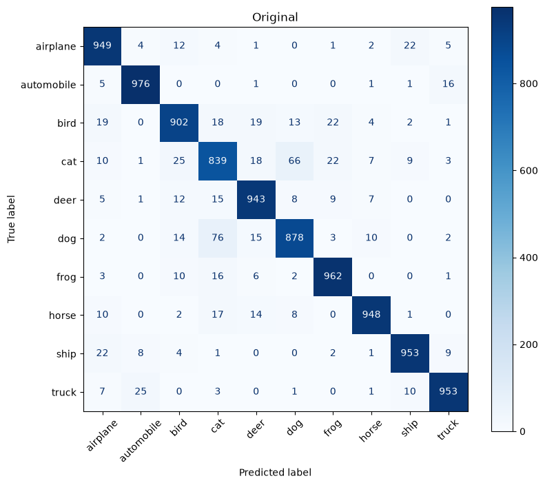
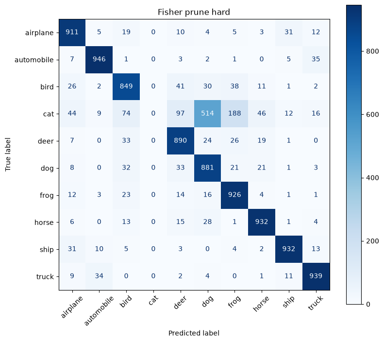
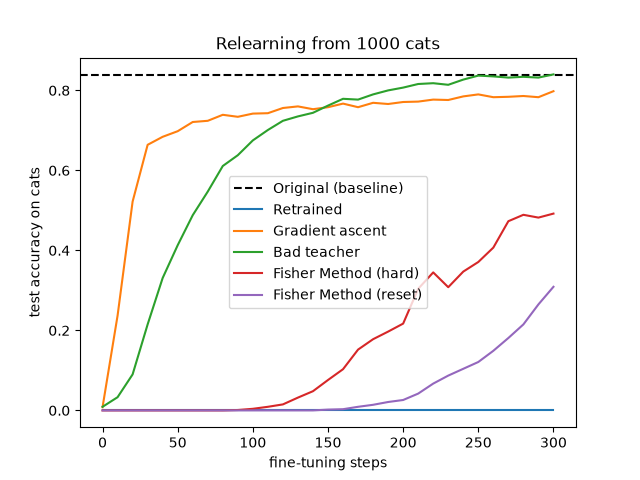

# Machine Unlearning on CIFAR-10 (ResNet-18): Output vs. Latent Space Audits

An empirical study and PyTorch implementation of **Class-Level Machine Unlearning** on CIFAR-10 (forgetting class `3`: `cat`) using a **ResNet-18** backbone. This repository builds on my earlier [MNIST Unlearning project](https://github.com/dmalik233/MNIST-Unlearning), scaling the same evaluation pipeline from a small 4-layer CNN to a deeper residual network on CIFAR-10.

Like the MNIST study, this project looks at why **output-space metrics alone can be misleading** when evaluating unlearning. Methods like **Gradient Ascent** (`0.8%` test forget accuracy) and **Bad Teacher Distillation** (`0.9%` test forget accuracy) successfully suppress `cat` predictions at the output layer, but leave the underlying feature representations in the backbone largely intact.

We compare these baselines against **Fisher Information Pruning** (including an ablation between **Hard Pruning** and **Synaptic Reset**) and evaluate all checkpoints across three tests:
1. **Output Space (`evaluate.py`):** Retain/Forget Accuracy, Jensen-Shannon (JS) Divergence against a Retrained-from-Scratch baseline, prediction distributions on forgotten `cat` images, and Confusion Matrices.
2. **Latent Representation Space (`probe.py`):** Linear probing on frozen 512-dimensional penultimate (`features`) embeddings to check how linearly separable `cat` features remain after unlearning.
3. **Relearning Speed (`relearn.py`):** Fine-tuning on a subset of `1,000` `cat` images alongside retain data for 300 steps  to test whether `cat` features were actually removed or just disconnected from the final classifier.

---

## 1. Architecture & Dataset Split

We use a CIFAR-adapted **ResNet-18** (`model.py`, **11,173,962 trainable parameters**):
* Because standard ImageNet ResNet-18 downsamples too aggressively for $32\times 32$ images, `conv1` is replaced with a $3\times 3$ convolution (`stride=1, padding=1`) and `maxpool` is replaced with `nn.Identity()`.
* `layer1` to `layer4`: Standard `BasicBlock` residual stages ($64 \to 128 \to 256 \to 512$ channels).
* `features(x)`: Returns the 512-dimensional embedding after `avgpool`.
* `fc`: $\text{Linear}(512 \to 10)$ classification head.

**CIFAR-10 Class-Split (`data.py`, target forget class = `3` / `cat`):**
* **Train Set:** `45,000` Retain images ($\mathcal{D}_r$, 9 non-cat classes) | `5,000` Forget images ($\mathcal{D}_f$, `cat`)
* **Test Set:** `9,000` Retain images | `1,000` Forget images
* **Data Augmentation:** Standard augmentation (`RandomCrop(32, padding=4)` and `RandomHorizontalFlip`) is used only when training the base `original_model.pt` and `retrained_model.pt` checkpoints (30 epochs, SGD with `lr=0.1`, `momentum=0.9`, `weight_decay=5e-4`, `CosineAnnealingLR`). Unlearning, evaluation, probing, and relearning all use clean unaugmented images (`augment=False`) so random crops do not introduce noise into Fisher estimation, KL distillation, or stopping checks.

---

## 2. Unlearning Methodologies (`unlearn.py`)

Moving from a plain CNN on MNIST to ResNet-18 required handling BatchNorm running statistics. Even if weights are updated, `BatchNorm2d` layers still hold `running_mean` and `running_var` stats from the original training run (or get skewed by `cat`-heavy batches during unlearning). 

As recently highlighted by Kalani et al. (2026), failing to control for these normalization states can result in measurement failures ("the BatchNorm illusion"), where low forget accuracy is caused by stale or corrupted running stats rather than true weight-space erasure. To control for this, `recalibrate_bn()` resets all BatchNorm stats (`reset_running_stats()`) and recomputes exact cumulative moving averages (`m.momentum = None`) over the retain subset in a single forward pass with weights frozen.

### A. Gradient Ascent (`grad_asc`)
Recalibrates BatchNorm on a `5,000`-image retain subset before starting, and keeps the model in `model.eval()` during the loop so `cat` batches do not corrupt the recalibrated BatchNorm statistics. It alternates between:
* **Ascent on $\mathcal{D}_f$:** Maximizes Cross-Entropy loss using plain `SGD(lr=1e-4)` without momentum (so ascent velocity doesn't build up and blow up the weights).
* **Descent on $\mathcal{D}_r$:** Minimizes Cross-Entropy loss using `SGD(lr=1e-3, momentum=0.9, weight_decay=5e-4)`.
* Checks accuracy every 5 batches and stops as soon as `forget_acc <= 0.01` (reached at **batch 35**).

### B. Bad Teacher Distillation (`bad_teacher`)
Follows the distillation setup from *Chundawat et al. (AAAI 2023)*. Combines 30% of $\mathcal{D}_r$ (`13,500` retain images, flag $l_u = 0$) with $\mathcal{D}_f$ (`5,000` cat images, flag $l_u = 1$) and trains the student model for 1 epoch (`lr=0.001`, `batch_size=128`) using KL-Divergence:
* **On Retain samples ($l_u = 0$):** Matches the softmax probabilities of the frozen original model (`good` teacher).
* **On Forget samples ($l_u = 1$):** Matches a noisy uniform distribution (`random_pred_generator`, centered at $1/10 = 0.10$ with Gaussian noise `noise_std=0.02`) acting as an incompetent teacher.
* BatchNorm statistics are recalibrated on the retain subset after the epoch finishes (which alone drops train forget accuracy from `8.20%` to `2.02%`).

### C. Fisher Information Pruning (`fisher_prune`)
Using the same diagonal Fisher approximation as the MNIST repo (*LeCun et al., 1990; Foster et al., 2024; Pochinkov & Schoots, 2024*), estimates parameter importance by averaging squared first-order gradients over matched `5,000`-sample subsets of $\mathcal{D}_f$ and $\mathcal{D}_r$ (`batch_size=64`):

$$F_{ii}(\mathcal{D}) = \frac{1}{\vert{}\mathcal{B}\vert{}} \sum_{b \in \mathcal{B}} \left( \frac{\partial \mathcal{L}_b}{\partial w_i} \right)^2, \qquad S_i = \frac{F_{ii}(\mathcal{D}_f)}{F_{ii}(\mathcal{D}_r) + 10^{-8}}$$

We leave early layers (`conv1`, `layer1`, and the main conv branches of `layer2`) untouched since they learn basic edges and textures shared across all classes. In the deeper blocks (`layer3` and `layer4`, plus the $1\times 1$ residual downsample shortcut `layer2.0.downsample.0.weight`), we prune the top **50%** (`prune_ratio=0.50`) of parameters with the highest forget-to-retain ratio $S_i$ (zeroing `5,246,976` weights in total). The output slice `fc[3]` is also reset to `0.0` and left unlocked so healing pushes `cat` logits negative.

We then heal the model on the `5,000`-image retain subset for 2 epochs (`lr=1e-3`) and recalibrate BatchNorm, testing two variants:
1. **Fisher Method (Hard Pruning, `lock_mask=True`):** Gradients of pruned weights are zeroed out before every step (`p.grad[masks[name]] = 0.0`) so pruned weights stay locked at `0.0`.
2. **Fisher Method (Synaptic Reset, `lock_mask=False`):** Pruned weights are set to `0.0` initially, but left unlocked during the 2 healing epochs so retain gradients can reuse them

---

## 3. Experimental Results

### Master Comparison Table

| Model / Method | Test Retain Acc ($\uparrow$) | Test Forget Acc ($\downarrow$) | JS Div Retain ($\downarrow$) | JS Div Forget ($\downarrow$) | Linear Probe Bal. Acc ($\to 0.9011$) | Linear Probe AUC ($\to 0.9616$) | Relearn Steps to 75% ($\uparrow$) | Relearn Acc @ 300 Steps ($\downarrow$) | ReAUC ($\downarrow$) |
| :--- | :---: | :---: | :---: | :---: | :---: | :---: | :---: | :---: | :---: |
| **Original Model** | `0.9404` | `0.8390` | `0.0287` | `0.5667` | `0.9252` | `0.9870` | `0` | `0.8390` | `1.0000` |
| **Retrained (Gold Standard)** | **`0.9468`** | **`0.0000`** | **`0.0000`** | **`0.0000`** | **`0.9011`** | **`0.9616`** | **`>300`** | **`0.0000`** | **`0.0000`** |
| **Gradient Ascent** | **`0.9367`** | `0.0080` | **`0.0302`** | `0.1903` | `0.9111` | `0.9796` | `120` | `0.7980` | `0.8544` |
| **Bad Teacher** | `0.9344` | `0.0090` | `0.0443` | `0.3832` | `0.9396` | `0.9868` | `150` | `0.8400` | `0.7759` |
| **Fisher Method (Hard)** | `0.9118` | **`0.0000`** | `0.0440` | `0.1717` | `0.8982` | **`0.9615`** | **`>300`** | `0.4920` | `0.1909` |
| **Fisher Method (Reset)** | `0.9222` | **`0.0000`** | `0.0365` | **`0.1506`** | **`0.9010`** | `0.9674` | **`>300`** | **`0.3090`** | **`0.0580`** |

---

## 4. Analysis

### 4.1 Output-Space Behaviour & Prediction Distributions (`evaluate.py`)
When the **Retrained** baseline (which never saw a `cat`) is given test `cat` images, it mostly predicts visually similar animal classes—primarily **`dog` (56.2%)**, **`frog` (15.2%)**, **`deer` (9.3%)**, and **`bird` (9.2%)**.

| Model | `airplane` | `auto` | `bird` | **`cat` (Target)** | `deer` | `dog` | `frog` | `horse` | `ship` | `truck` |
| :--- | :---: | :---: | :---: | :---: | :---: | :---: | :---: | :---: | :---: | :---: |
| **Original** | 1.0% | 0.1% | 2.5% | **83.9%** | 1.8% | 6.6% | 2.2% | 0.7% | 0.9% | 0.3% |
| **Retrained (Ideal)** | 2.6% | 0.5% | **9.2%** | **0.0%** | **9.3%** | **56.2%** | **15.2%** | 4.1% | 1.6% | 1.3% |
| **Gradient Ascent** | 3.8% | 0.8% | **16.5%** | **0.8%** | 8.1% | **48.6%** | 7.6% | **11.6%** | 0.9% | 1.3% |
| **Bad Teacher** | **20.3%** | 4.7% | 10.8% | **0.9%** | 6.9% | 11.4% | **28.7%** | 6.5% | 7.1% | 2.7% |
| **Fisher (Hard)** | 4.4% | 0.9% | **7.4%** | **0.0%** | **9.7%** | **51.4%** | **18.8%** | 4.6% | 1.2% | 1.6% |
| **Fisher (Reset)** | 3.9% | 0.4% | **7.3%** | **0.0%** | **10.4%** | **56.6%** | **13.6%** | 5.4% | 1.1% | 1.3% |

* **Bad Teacher JS Divergence (`0.3832`):** Because Bad Teacher forces `cat` images toward a noisy uniform distribution, the model scatters `cat` predictions onto unrelated classes like **`airplane` (`20.3%`)** and **`frog` (`28.7%`)**, resulting in a high JS divergence against the Retrained baseline.
* **Fisher Pruning (`0.1717` Hard / `0.1506` Reset):** Both Fisher models map forgotten cats onto the same animal neighbors as the Retrained model (`56.6%` dog, `13.6%` frog, and `10.4%` deer in Fisher Reset), giving the lowest JS divergence on the forget set.
* **Retain Accuracy Trade-off:** Zeroing `5.25M` weights in `layer3` and `layer4` and healing on a `5,000`-image subset (without data augmentation) causes a `~1.8%` to `2.8%` dip in test retain accuracy (`0.9222` in Reset and `0.9118` in Hard, compared to `0.9404` in Original). Letting the zeroed weights update during healing (**Fisher Reset**) recovers `+1.04%` test retain accuracy over keeping them locked (Fisher Hard).

#### Confusion Matrices across Models
| Original Model | Retrained (Gold Standard) |
| :---: | :---: |
|  |  |
| **Gradient Ascent** | **Bad Teacher** |
|  |  |
| **Fisher Method (Hard Pruning)** | **Fisher Method (Synaptic Reset)** |
|  |  |

---

### 4.2 Latent Feature Audit via Linear Probing (`probe.py`)
We freeze each model's backbone, extract the 512-dimensional embeddings (`model.features(x)`) for all `50,000` training and `10,000` test images, standardize them with `StandardScaler`, and train a binary `LogisticRegression(class_weight="balanced")` classifier (`cat` vs. non-`cat`).

1. **Retrained Baseline (`0.9011` Bal. Acc | `0.9616` AUC):** Even without ever training on cats, general animal and texture filters learned from dogs, deer, horses, and frogs allow a linear probe to separate cats at `0.9011` balanced accuracy. The goal of unlearning in feature space is to bring the probe accuracy down from `0.9252` (**Original**) to this `0.9011` baseline.
2. **Why Bad Teacher Increases Probe Accuracy (`0.9396` Bal. Acc):** Interestingly, Bad Teacher makes `cat` embeddings *more* linearly separable than they were in the Original model (`0.9396` vs. `0.9252`). Because retain images ($l_u = 0$) are trained to produce confident, peaked predictions while all `cat` images ($l_u = 1$) are forced to produce flat, uniform logits (`~0.10` across all classes), the network pushes `cat` embeddings into a tight, separate region of the 512-dim space—making it even easier for a linear probe to tell them apart from retain classes.
3. **Fisher Pruning Matches the Retrained Baseline (`0.8982` Hard | `0.9010` Reset):** Pruning `layer3`, `layer4`, and `layer2.0.downsample.0` brings linear probe separability down to `0.8982` (Hard) and `0.9010` (Reset), matching the Retrained baseline (`0.9011`).

---

### 4.3 Relearning Stress Test (`relearn.py`)
To test how easily each model re-acquires the forgotten class, we fine-tune each checkpoint for 300 steps (`SGD`, `lr=1e-4`, `momentum=0.9`, `weight_decay=5e-4`) using a fixed subset of `1,000` training `cat` images (`cat_batch=16`) mixed with `train_retain` (`retain_batch=64`). Alongside steps to reach `75%` accuracy, we compute **ReAUC** (the area under the relearning curve normalized by the Original model's `0.8390` accuracy).



* **Retrained Baseline (`0.0000` ReAUC):** At `lr=1e-4` with only 16 cats per batch, 300 steps are not enough for the Retrained model to learn `cat` features from scratch—it stays at `0.0000` across the entire run. This means any accuracy recovered by the unlearned models during these 300 steps comes from reactivating leftover features that were not fully erased.
* **Gradient Ascent (`0.8544` ReAUC) & Bad Teacher (`0.7759` ReAUC):** Both methods recover rapidly, hitting `75%` accuracy in `120` and `150` steps. Because Bad Teacher kept `cat` features tightly clustered in the penultimate layer (`0.9396` probe), once the final `fc` layer rotates back into alignment around step 145, its accuracy overtakes Gradient Ascent and reaches `0.8400` by step 300.
* **Fisher Hard (`0.1909` ReAUC) vs. Fisher Reset (`0.0580` ReAUC):**
  * Neither Fisher model reaches 75% accuracy within 300 steps (`>300`).
  * **Synaptic Reset (`0.0580` ReAUC, final acc `0.3090`)** resists relearning much longer than **Hard Pruning (`0.1909` ReAUC, final acc `0.4920`)**, staying flat at `0.0000` until around step 150. When pruned weights are locked at `0.0` during healing (`lock_mask=True`), they sit at zero until `relearn.py` starts, at which point they immediately begin absorbing `cat` gradients. When left unlocked during healing (`lock_mask=False`), those weights get overwritten to serve the 9 retain classes first, slowing down relearning.
  * *(Note: Unlike the Retrained baseline, both Fisher models still begin recovering some accuracy after step 100–150. Because `conv1`, `layer1`, and the main branches of `layer2` were not pruned, low-level features learned from all 50,000 images remain in the early layers, helping the deeper layers rebuild `cat` representations faster than a model trained from scratch without cats.)*

---

## 5. Repository Structure & Setup

```text
cifar10-resnet18-unlearning/
├── data.py                  # CIFAR-10 downloader, augmentation toggle, and class-3 (cat) splitter
├── model.py                 # CIFAR-adapted ResNet-18 with decoupled .features() and .forward() passes
├── utils.py                 # Seed control, CUDA/MPS/CPU device selection, checkpoint loader
├── evalutils.py             # Accuracy, softmax probabilities, JS divergence, confusion matrices
├── train.py                 # Trains Original model on all 10 classes -> checkpoints/original_model.pt
├── train_ideal_baseline.py  # Trains Retrained baseline on retain set -> checkpoints/retrained_model.pt
├── unlearn.py               # Runs BN recalibration, Gradient Ascent, Bad Teacher, and Fisher Prune
├── evaluate.py              # Computes output metrics, JS divergence, and saves confusion matrices
├── probe.py                 # Trains balanced LogisticRegression probes on frozen 512-dim features
├── relearn.py               # Runs 300-step (1000 cats) relearning benchmark, ReAUC, and plot
├── requirements.txt         
├── .gitignore               
├── checkpoints/             # Saved .pt model state dictionaries
└── results/                 # Generated confusion matrices and relearning plots
```

### Environment Setup
Clone the repository, create a virtual environment, and install the dependencies from `requirements.txt`:

```bash
git clone https://github.com/dmalik233/cifar10-resnet18-unlearning.git
cd cifar10-resnet18-unlearning

# Create and activate virtual environment (macOS / Linux)
python3 -m venv .venv
source .venv/bin/activate

# Install dependencies
pip install -r requirements.txt
```

### Run the Full Pipeline
```bash
# 1. Verify dataset splits (downloads CIFAR-10 into data/ automatically)
python3 data.py

# 2. Train Original Model and Retrained Gold-Standard Baseline
python3 train.py
python3 train_ideal_baseline.py

# 3. Run all Unlearning Algorithms (saves 4 unlearned checkpoints)
python3 unlearn.py

# 4. Run Output, Latent Probe, and Relearning Audits
python3 evaluate.py
python3 probe.py
python3 relearn.py
```

---

## 6. References
1. **Bad Teacher Distillation:** Chundawat, V. S., Tarun, A. K., Mandal, M., & Kankanhalli, M. (2023). *Can Bad Teaching Induce Forgetting? Unlearning in Deep Networks Using an Incompetent Teacher*. AAAI Conference on Artificial Intelligence.
2. **Diagonal Hessian Approximation for Pruning:** LeCun, Y., Denker, J., & Solla, S. (1990). *Optimal Brain Damage*. Advances in Neural Information Processing Systems (NeurIPS).
3. **Fisher Information Ratio for Unlearning:** Foster, J., Schoepf, S., & Brintrup, A. (2024). *Fast Machine Unlearning Without Retraining Through Selective Synaptic Dampening*. AAAI Conference on Artificial Intelligence.
4. **Forget-to-Retain Pruning Criterion:** Pochinkov, N., & Schoots, N. (2024). *Dissecting Language Models: Machine Unlearning via Selective Pruning*.
5. **The BatchNorm Illusion:** Kalani, A., Mandal, M., Kumar, D., Kankanhalli, M., & Sinha, Y. (2026). *The BatchNorm Illusion: Diagnosing Normalization Artifacts in Machine Unlearning Evaluation.* 
